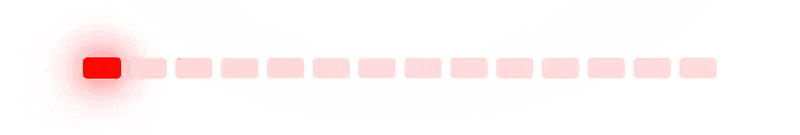

<div align="center">

<a href="https://git.io/typing-svg">
  
</a>

<h3>Software Engineering Undergraduate • Full-Stack Developer • Cloud & DevOps Enthusiast</h3>

<p>Building full-stack apps with React, .NET, Spring Boot and Python, and shipping them with Docker & Kubernetes.</p>

<a href="https://thilix.github.io/"></a>


<br><br>



<br><br>



</div>

<details open>
<summary><b>pulsewatch</b> · API monitoring &amp; alerts &nbsp; </summary>
<br>

Self-hostable API monitoring with incidents, email alerts, uptime dashboards and SSRF protection.<br>
`C#` `.NET` `PostgreSQL` `React` `Docker` · [**Repo →**](https://github.com/ThiliX/pulsewatch)

</details>

<details>
<summary><b>servora</b> · multi-tenant AI support &nbsp; </summary>
<br>

Cited answers from each business's own documents, Row-Level Security isolation and AI-to-human handoff.<br>
`Spring Boot` `FastAPI` `pgvector` `React` · [**Repo →**](https://github.com/ThiliX/Servora)

</details>

<details>
<summary><b>talentiq</b> · AI recruitment (team) &nbsp; </summary>
<br>

Team project. I built the AI module: Gemini résumé matching with fallback scoring.<br>
`ASP.NET Core` `React` `Gemini API` · [**Repo →**](https://github.com/TalentIq-team/talentIQ)

</details>

<details>
<summary><b>portfolio-xp</b> · boots like a 2000s PC &nbsp;</summary>
<br>

Portfolio that boots like an early-2000s PC, with windows, a Start menu and built-in apps.<br>
`React` `JavaScript` `Web Audio` · [**Repo →**](https://github.com/ThiliX/Retro-Computer) · [**▶ Live demo**](https://thilix.github.io/Retro-Computer/)

</details>

<details>
<summary><b>devops-practical</b> · CI → Docker Hub → K8s &nbsp; </summary>
<br>

Flask app through CI, Docker Hub and Kubernetes, verified by a self-healing chaos test.<br>
`Python` `GitHub Actions` `Docker` `Kubernetes` · [**Repo →**](https://github.com/ThiliX/devops-practical)

</details>

```console
thilix@github:~$ kubectl describe thilix
side quests   AI & automation · Discord bots · UI/UX
status        ● open to internships
```

➡️ More on my **[portfolio](https://thilix.github.io/)**.

---

## 🛠️ Tools I Use

<table>
  <tr>
    <td><b>Languages</b></td>
    <td>
      <a href="https://www.java.com/"></a>
      <a href="https://www.python.org/"></a>
      <a href="https://dotnet.microsoft.com/en-us/languages/csharp"></a>
      <a href="https://www.typescriptlang.org/"></a>
    </td>
  </tr>
  <tr>
    <td><b>Frameworks</b></td>
    <td>
      <a href="https://react.dev/"></a>
      <a href="https://dotnet.microsoft.com/"></a>
      <a href="https://spring.io/"></a>
    </td>
  </tr>
  <tr>
    <td><b>Cloud &amp; DevOps</b></td>
    <td>
      <a href="https://www.docker.com/"></a>
      <a href="https://kubernetes.io/"></a>
      <a href="https://github.com/features/actions"></a>
      <a href="https://azure.microsoft.com/"></a>
    </td>
  </tr>
  <tr>
    <td><b>Data</b></td>
    <td>
      <a href="https://www.postgresql.org/"></a>
      <a href="https://www.mysql.com/"></a>
      <a href="https://firebase.google.com/"></a>
    </td>
  </tr>
</table>

---

## 🌐 How To Reach Me

<div align="center">
<table>
  <tr>
    <td align="center" width="100"><a href="https://github.com/ThiliX" target="_blank"><br><br><b>GitHub</b></a></td>
    <td align="center" width="100"><a href="https://www.linkedin.com/in/thilix/" target="_blank"><br><br><b>LinkedIn</b></a></td>
    <td align="center" width="100"><a href="https://twitter.com/Thilix4Seven" target="_blank"><br><br><b>X</b></a></td>
    <td align="center" width="100"><a href="https://discord.com/" target="_blank"><br><br><b>Discord</b></a></td>
    <td align="center" width="100"><a href="mailto:wickramanayakethilina95@gmail.com"><br><br><b>Gmail</b></a></td>
  </tr>
</table>
</div>

---

<div align="center">

### *"Imagine. Design. Build. Repeat."*


</div>
