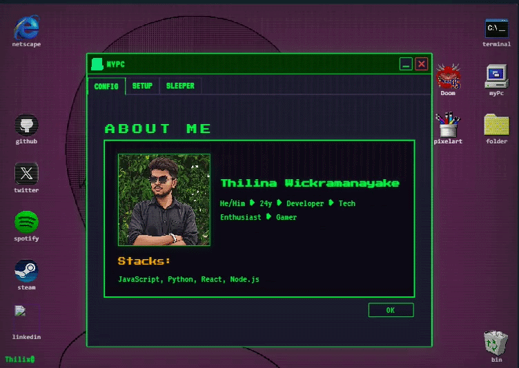

<div align="center">

<a href="https://git.io/typing-svg">
  
</a>

<h3>Software Engineering Undergraduate • Full-Stack Developer • Cloud & DevOps Enthusiast</h3>

<p>Building full-stack apps with React, .NET, Spring Boot and Python, shipping them with Docker & Kubernetes, and creating creative digital experiences.</p>

<a href="https://thilix.github.io/"></a>


</div>

<br>

<table border="0" cellspacing="0" cellpadding="0" width="100%" style="border:none; border-collapse:collapse;">
  <tr style="border:none;">
    <td width="42%" valign="middle" style="border:none;">
      <div align="center">
        
        
      </div>
    </td>
    <td width="52%" valign="middle" style="border:none;">
      
    </td>
  </tr>
</table>

---

## 👨‍💻 Who Am I?

```yaml
Name: Thilina Niroshan Wickramanayake
Location: Sri Lanka 🇱🇰
Education: Software Engineering Undergraduate @ NSBM Green University (2028)
Portfolio: https://thilix.github.io/

Interests:
  - Full-Stack Development
  - Cloud Computing & DevOps
  - Artificial Intelligence
  - Discord Development
  - Marvel & Fortnite Content

Currently Learning:
  - Cloud Technologies (Azure)
  - Kubernetes & CI/CD
  - Advanced Java & Spring Boot
```

---

## 🚀 What Am I Currently Working On?

- 🔭 Building full-stack applications with React, .NET and Spring Boot
- ☁️ Shipping apps with Docker, GitHub Actions and Kubernetes
- 🌱 Learning advanced software engineering concepts
- 🤖 Exploring AI & automation technologies
- 🎮 Creating Discord bots
- ⚡ Improving UI/UX designs

---

## 📌 Featured Projects

| Project | Description | Stack |
|---|---|---|
| [**PulseWatch**](https://github.com/ThiliX/pulsewatch) | Self-hostable API monitoring with incidents, email alerts, uptime dashboards and SSRF protection | C# · .NET · PostgreSQL · React · Docker |
| [**Servora**](https://github.com/ThiliX/Servora) | Multi-tenant AI customer-support platform: cited answers from each business's documents, Row-Level Security isolation and AI-to-human handoff | Spring Boot · FastAPI · pgvector · React |
| [**TalentIQ**](https://github.com/TalentIq-team/talentIQ) | AI-assisted recruitment platform (team project). I built the AI module: Gemini résumé matching and fallback scoring | ASP.NET Core · React · Gemini API |
| [**Portfolio XP**](https://github.com/ThiliX/Retro-Computer) · [▶ Live](https://thilix.github.io/Retro-Computer/) | Portfolio that boots like an early-2000s PC, with windows, a Start menu and built-in apps | React · JavaScript · Web Audio |
| [**DevOps Practical**](https://github.com/ThiliX/devops-practical) | Flask app through CI, Docker Hub and Kubernetes with a self-healing chaos test | Python · GitHub Actions · Docker · Kubernetes |

➡️ See more on my **[portfolio](https://thilix.github.io/)**.

---

## 🛠️ Tools I Use

<div align="center">
<table>
  <tr>
    <td align="center" width="100"><a href="https://www.java.com/" target="_blank"><br><br><b>Java</b></a></td>
    <td align="center" width="100"><a href="https://www.python.org/" target="_blank"><br><br><b>Python</b></a></td>
    <td align="center" width="100"><a href="https://dotnet.microsoft.com/en-us/languages/csharp" target="_blank"><br><br><b>C#</b></a></td>
    <td align="center" width="100"><a href="https://spring.io/" target="_blank"><br><br><b>Spring</b></a></td>
    <td align="center" width="100"><a href="https://www.mysql.com/" target="_blank"><br><br><b>MySQL</b></a></td>
    <td align="center" width="100"><a href="https://firebase.google.com/" target="_blank"><br><br><b>Firebase</b></a></td>
    <td align="center" width="100"><a href="https://www.jetbrains.com/idea/" target="_blank"><br><br><b>IntelliJ</b></a></td>
  </tr>
  <tr>
    <td align="center" width="100"><a href="https://git-scm.com/" target="_blank"><br><br><b>Git</b></a></td>
    <td align="center" width="100"><a href="https://github.com/" target="_blank"><br><br><b>GitHub</b></a></td>
    <td align="center" width="100"><a href="https://code.visualstudio.com/" target="_blank"><br><br><b>VS Code</b></a></td>
    <td align="center" width="100"><a href="https://visualstudio.microsoft.com/" target="_blank"><br><br><b>Visual Studio</b></a></td>
    <td align="center" width="100"><a href="https://www.postman.com/" target="_blank"><br><br><b>Postman</b></a></td>
    <td align="center" width="100"><a href="https://www.figma.com/" target="_blank"><br><br><b>Figma</b></a></td>
    <td align="center" width="100"><a href="https://www.docker.com/" target="_blank"><br><br><b>Docker</b></a></td>
  </tr>
  <tr>
    <td align="center" width="100"><a href="https://react.dev/" target="_blank"><br><br><b>React</b></a></td>
    <td align="center" width="100"><a href="https://www.typescriptlang.org/" target="_blank"><br><br><b>TypeScript</b></a></td>
    <td align="center" width="100"><a href="https://dotnet.microsoft.com/" target="_blank"><br><br><b>.NET</b></a></td>
    <td align="center" width="100"><a href="https://www.postgresql.org/" target="_blank"><br><br><b>PostgreSQL</b></a></td>
    <td align="center" width="100"><a href="https://kubernetes.io/" target="_blank"><br><br><b>Kubernetes</b></a></td>
    <td align="center" width="100"><a href="https://github.com/features/actions" target="_blank"><br><br><b>Actions</b></a></td>
    <td align="center" width="100"><a href="https://azure.microsoft.com/" target="_blank"><br><br><b>Azure</b></a></td>
  </tr>
</table>
</div>

---

## 🌐 How To Reach Me

<div align="center">
<table>
  <tr>
    <td align="center" width="100"><a href="https://github.com/ThiliX" target="_blank"><br><br><b>GitHub</b></a></td>
    <td align="center" width="100"><a href="https://www.linkedin.com/in/thilix/" target="_blank"><br><br><b>LinkedIn</b></a></td>
    <td align="center" width="100"><a href="https://twitter.com/Thilix4Seven" target="_blank"><br><br><b>X</b></a></td>
    <td align="center" width="100"><a href="https://discord.com/" target="_blank"><br><br><b>Discord</b></a></td>
    <td align="center" width="100"><a href="mailto:wickramanayakethilina95@gmail.com"><br><br><b>Gmail</b></a></td>
  </tr>
</table>
</div>

---

<div align="center">

### *"Imagine. Design. Build. Repeat."* 🎨


</div>
